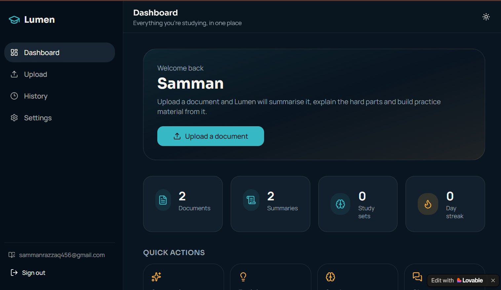
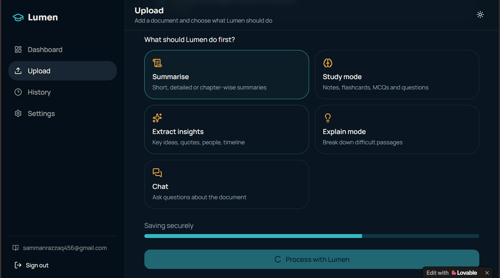
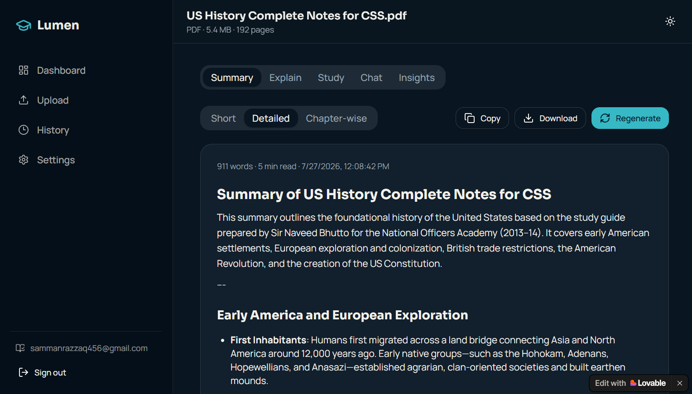
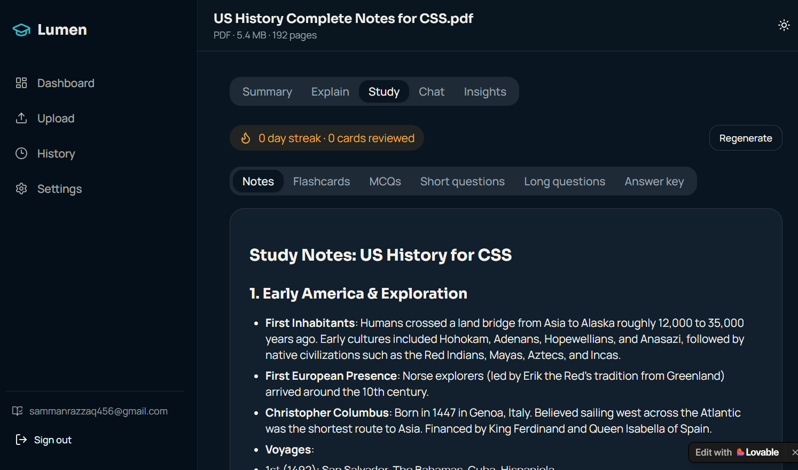
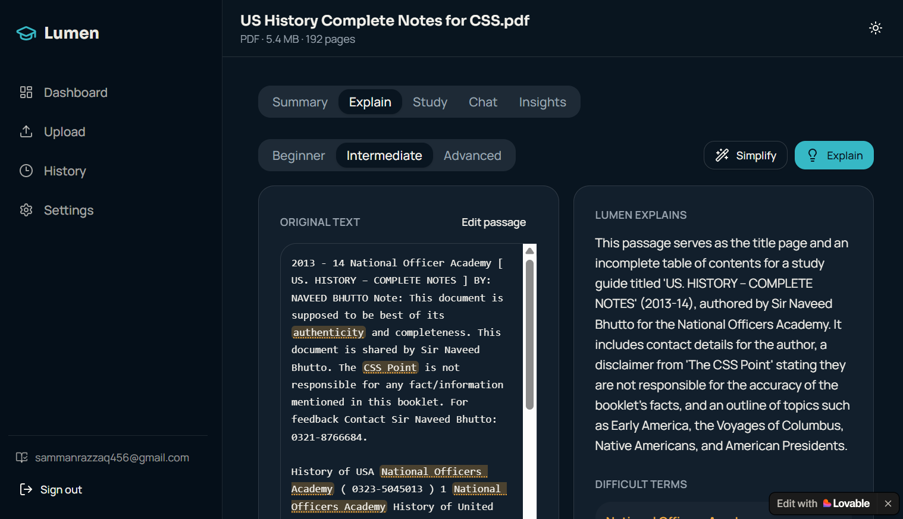
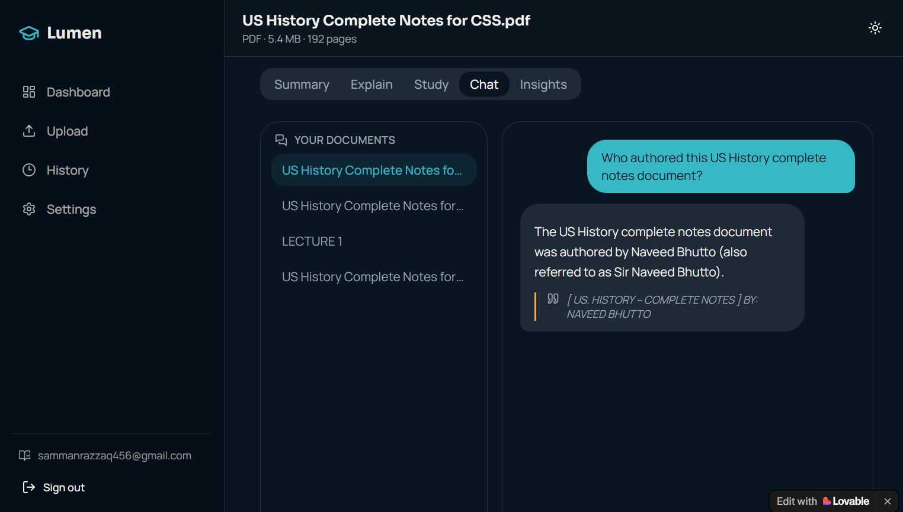
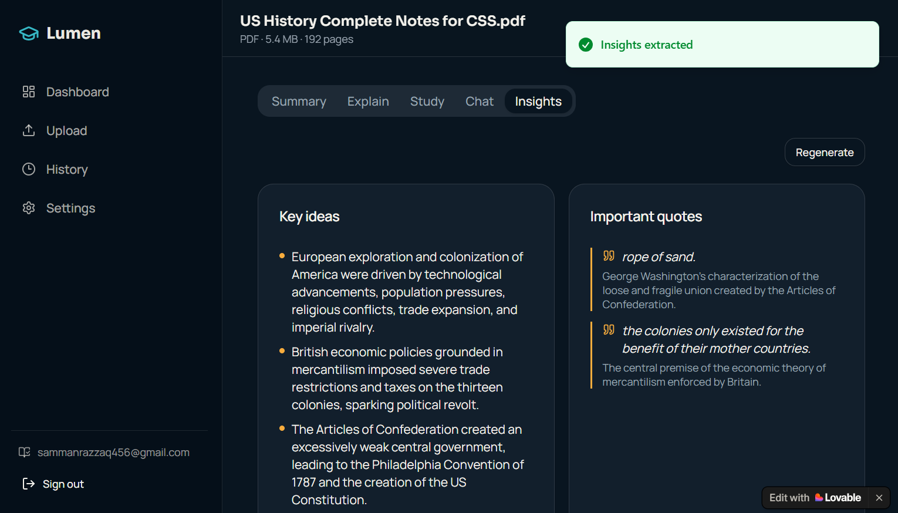

# Lumen — AI Study Companion

## Problem
Students and learners often struggle to turn long documents (PDFs, DOCX, notes) into usable study material. Reading everything takes too long, and it's hard to quickly find key points, get explanations, or test your own understanding. Lumen solves this by turning any uploaded document into summaries, explanations, study aids, and an interactive Q&A — instantly.

## Live Demo
🔗 https://learn-ly-workspace.lovable.app

## Features
- Upload a document (PDF, DOCX, or notes) to your personal workspace
- Summary — generates a structured summary of the document
- Explain — breaks down difficult concepts from the document in simple terms
- Study — generates study notes and key points for revision
- Chat — ask questions and get answers grounded strictly in the document
- Insights — extracts key ideas and important quotes from the document
- User authentication (signup/login)
- Personal dashboard showing document count and activity
- Document history — access previously uploaded documents anytime

## AI Feature
Lumen's core AI feature reads an uploaded document and powers five different modes (Summary, Explain, Study, Chat, Insights) — all of which stay strictly grounded in the document's actual content, never inventing facts, quotes, or dates that aren't there.

System prompt used:

You are Lumen, a study assistant. Answer strictly from the supplied document. If the document does not contain the answer, say so plainly. Never invent facts, quotes or dates.

## Built With
- Lovable — AI app builder (https://lovable.dev)
- Supabase — database, authentication, and Edge Functions
- Lovable AI Gateway — AI model integration
- GitHub — version control

## Screenshots

## How to Run Locally
1. Clone this repo: git clone https://github.com/sammanrazzaq456-rgb/learn-ly-workspace.git
2. Install dependencies: npm install
3. Set up environment variables (see .env for required Supabase keys)
4. Run: npm run dev
